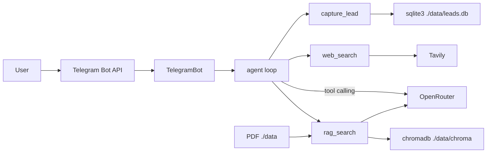

# Техническое видение

Документ — отправная точка для разработки ИИ-агента-консультанта из `docs/idea.md`: Telegram-бот отвечает на вопросы по PDF компании, проверяет актуальные факты в интернете и фиксирует заявку на консультацию. Цель: максимально простое решение, которое работает постоянно в облаке Railway.

## Технологии

| Слой | Выбор |
|---|---|
| Язык | Python 3.12 |
| Зависимости | uv (`pyproject.toml` + lock-файл) |
| Telegram | aiogram 3, long polling |
| Agent loop | openai SDK, tool calling |
| LLM и embeddings | пакет openai, один `LLM_BASE_URL` (OpenRouter): чат и эмбеддинги; модель эмбеддингов `text-embedding-3-small`, задаётся в `.env` |
| Векторная БД | chromadb, persistent, `./data/chroma` |
| PDF | pymupdf4llm |
| Веб-поиск | tavily-python (Tavily Search API) |
| Лиды | sqlite3 (стандартная библиотека), `./data/leads.db` |
| Мониторинг | langsmith, опционально, `LANGSMITH_ENABLED=false` |
| Конфиг | переменные окружения; системный промпт — файл, путь в `.env` |
| Логи | стандартный модуль `logging` |
| Запуск | Make (локально и через Docker) |
| Контейнер | Docker: локальный запуск и сборка образа для облака; volume `./data` |
| Хостинг | Railway (Docker-образ из репозитория) |

Без LangChain и других AI-фреймворков. Кроме строк таблицы — только `python-dotenv`.

Long polling выбран сознательно: боту не нужен публичный адрес, поэтому он одинаково запускается и на компьютере разработчика, и в Railway без дополнительной настройки сети.

## Принцип разработки

- Цель: минимальный агент-консультант — отвечает по документам компании, проверяет факты в интернете и записывает лида.
- KISS: избегаем лишних слоёв и абстракций; добавляем только то, что напрямую нужно.
- Функциональный стиль: один модуль — одна задача, функции вместо классов. async везде; синхронные вызовы chromadb, sqlite3 и разбор PDF уходят в `asyncio.to_thread`, чтобы не блокировать цикл.
- Агентный цикл явный и читаемый: обычный цикл tool calling в одном модуле, каждый шаг виден в коде. Без LangChain и тяжёлых AI-фреймворков — только openai SDK и минимальные библиотеки.
- Ясные границы ответственности:
	- `config` — чтение и валидация окружения, загрузка системного промпта из файла;
	- `agent` — цикл: запрос к модели, вызов инструментов, повтор, пока нет итогового ответа;
	- `tools` — три инструмента: `rag_search`, `web_search`, `capture_lead`;
	- `llm` — chat и embeddings через один клиент openai;
	- `rag` — разбор PDF и поиск по chromadb;
	- `leads` — запись лида в sqlite;
	- `telegram_bot` — приём сообщений через aiogram (polling) и ответ в чат;
	- `runner` — сборка и запуск long-polling.
- Конфиг и секреты — только через переменные окружения; `.env` — только для локальной разработки (не коммитить), в облаке — Railway Variables. Текст роли живёт в `prompts/system.txt`, в окружении хранится путь к файлу.
- Персистентность только у индекса и лидов (`./data`). История диалога — в памяти процесса.
- Обработка ошибок: таймауты и ретраи. Сбой инструмента не роняет бота: агент сообщает, что не смог проверить или сохранить заявку.
- Тестируемость: отделяем I/O от логики; инструменты, поиск и Telegram легко мокируются.
- Минимум зависимостей: `aiogram`, `openai`, `python-dotenv`, `chromadb`, `pymupdf4llm`, `tavily-python`. `langsmith` подключается только при включённом мониторинге.

## Структура проекта

```
pyproject.toml
uv.lock
.env.example
Makefile
Dockerfile
railway.json          # опционально: настройки сборки и перезапуска в Railway
prompts/
	system.txt         # системный промпт консультанта
docs/
	idea.md
	vision.md
	tasklist.md
	adrs/
data/                  # PDF компании, индекс и база лидов; каталог монтируется volume
	chroma/
	leads.db
bot/tools/
	rag.py             # поиск по индексу chromadb
	web.py             # поиск Tavily
scripts/
	index_pdf.py       # PDF → фрагменты → chromadb
src/my_first_bot/
	__init__.py
	config.py          # окружение и чтение системного промпта
	logger.py          # настройка logging
	llm_client.py      # chat и embeddings через openai SDK
	agent.py           # явный цикл tool calling
	tools.py           # схемы и вызов rag_search, web_search, capture_lead
	leads.py           # запись лида в sqlite
	telegram_bot.py    # aiogram handlers (polling)
	runner.py          # сборка и запуск polling
```

## Архитектура

Приложение — однопроцессный асинхронный сервис (asyncio), использующий long-polling aiogram для приёма сообщений. Агентский цикл — прямая функция: модель решает, какой инструмент вызвать, код выполняет его и возвращает результат модели.

Компоненты и взаимодействие:



При старте `scripts/index_pdf.py` читает PDF из `./data` через pymupdf4llm, считает эмбеддинги тем же клиентом openai (`OPENAI_BASE_URL`) и пишет фрагменты в `./data/chroma`. Уже проиндексированный файл повторно не обрабатывается.

### Сценарий 1: ответ по документам компании

1. Пользователь пишет вопрос в личный чат с ботом.
2. `telegram_bot` передаёт сообщение и короткую историю чата в `agent`.
3. Модель вызывает `rag_search`: поиск ближайших фрагментов портфолио, услуг и описаний программ курсов.
4. Агент отвечает по найденным фрагментам и не добавляет фактов, которых в них нет.

### Сценарий 2: проверка актуальных фактов

1. Вопрос про услуги компании, и в нём нужна версия, вендор или дата.
2. Модель вызывает `web_search`. Tavily возвращает краткие актуальные результаты.
3. Итоговый ответ опирается на них и на документы компании. Общие новости и вопросы не об услугах бот не ищет: вежливо отказывает.

### Сценарий 3: заявка на консультацию

1. По ходу диалога бот сам предлагает оставить заявку и просит имя и контакт.
2. Когда оба есть, модель вызывает `capture_lead`.
3. `leads` записывает лида в `./data/leads.db` и возвращает номер. Бот подтверждает, что заявка принята.
4. Если имени или контакта ещё нет, инструмент не вызывается: бот задаёт недостающий вопрос.

### Диалог

Бот работает в личном чате. Короткая история сообщений хранится в памяти, чтобы собрать имя и контакт за несколько реплик. После перезапуска история пропадает, записанные лиды и индекс — нет.

### Надёжность и ограничения

- Таймауты для запросов к модели, эмбеддингам и Tavily (20–30 с), ретраи для временных ошибок с ограничением числа попыток.
- Цикл агента ограничен небольшим числом шагов. Если инструменты кончились, а ответа нет, пользователь получает короткое сообщение.
- Деградация вместо отказа: нет фрагментов в индексе — бот говорит, что в документах этого нет; поиск недоступен — бот не выдумывает свежие факты; запись лида не удалась — бот просит повторить контакт.
- Один процесс пишет в chromadb и sqlite. Второй экземпляр с тем же `./data` не запускаем.
- Логирование без секретов: события, ошибки и latency. Контакты лидов в лог не пишем.

### Конкурентность и масштабирование

- Один процесс / один экземпляр сервиса; aiogram асинхронно обрабатывает несколько чатов.
- Два процесса с long polling на одном токене конфликтуют (ошибка Telegram 409 Conflict), поэтому одновременно работает только один экземпляр: либо локальный, либо в Railway.
- Горизонтальное масштабирование потребует вынести chromadb и sqlite и перейти на webhook — отдельный ADR.

### Безопасность

- Секреты только в окружении; не логировать ключи и контакты лидов.

## Модель данных

Индекс и лиды лежат в `./data`. История диалога — в памяти.

- Фрагмент в chromadb:
	- текст фрагмента PDF;
	- имя файла-источника;
	- эмбеддинг `text-embedding-3-small`.
- `Lead` в `leads.db`:
	- `id: int` — номер заявки;
	- `name: str`;
	- `contact: str`;
	- `chat_id: int` — чат, из которого пришла заявка;
	- `created_at: datetime`.
- История чата: список последних сообщений `user` / `assistant` по `chat_id`, только в памяти.

## Работа с ИИ

Один async-клиент openai. Базовый URL — `OPENAI_BASE_URL` (OpenRouter): и chat completions с tool calling, и embeddings. Ключ один (`OPENAI_API_KEY` или `OPENROUTER_API_KEY`).

| Задача | Модель | Откуда |
|---|---|---|
| Диалог и выбор инструмента | `MODEL_TEXT` | `.env` |
| Эмбеддинги фрагментов и запроса | `EMBEDDING_MODEL`, по умолчанию `openai/text-embedding-3-small` | `.env` |

Системный промпт читается из файла. Путь — `SYSTEM_PROMPT_FILE`, по умолчанию `prompts/system.txt`. В промпте роль консультанта llmstart: отвечать только про услуги компании по документам через `rag_search`, вежливо отказывать за этими границами, вызывать `web_search` только для версии, вендора или даты в вопросе об услугах, `capture_lead` — когда пользователь назвал имя и контакт. Ответ перед отправкой в Telegram очищается от `**`.

Инструменты передаются в chat completions как tools:

| Инструмент | Когда | Результат |
|---|---|---|
| `rag_search` | вопрос о компании, услугах, курсах, портфолио | релевантные фрагменты PDF |
| `web_search` | версия, вендор или дата в вопросе об услугах компании | краткие результаты Tavily |
| `capture_lead` | есть имя и контакт | номер записанного лида |

Цикл в `agent`: сообщения и список tools уходят в модель; если в ответе есть tool calls — каждый вызывается, результат добавляется в историю, запрос повторяется; если модель вернула текст — он уходит пользователю.

Мониторинг: при `LANGSMITH_ENABLED=false` трассировки нет. При `true` ход пользователя — один трейс `agent_run`, внутри него вызовы модели и инструментов. Поток диалога — `thread_id` вида `{user_id}-{uniq}`; команда `/start` начинает новый поток.

## Конфигурация

| Переменная | Обязательна | Назначение |
|---|---|---|
| `TELEGRAM_TOKEN` | да | Токен бота |
| `OPENAI_API_KEY` | да | Ключ OpenRouter для чата и эмбеддингов; подойдёт и `OPENROUTER_API_KEY` |
| `OPENAI_BASE_URL` | нет | Базовый URL, по умолчанию `https://openrouter.ai/api/v1` |
| `MODEL_TEXT` | нет | Модель диалога с tool calling, по умолчанию `openai/gpt-4o-mini` |
| `EMBEDDING_MODEL` | нет | Модель эмбеддингов, по умолчанию `openai/text-embedding-3-small` |
| `TAVILY_API_KEY` | да | Ключ Tavily Search API |
| `SYSTEM_PROMPT_FILE` | нет | Путь к системному промпту, по умолчанию `prompts/system.txt` |
| `LANGSMITH_ENABLED` | нет | Трассировка LangSmith, по умолчанию `false` |
| `LANGSMITH_API_KEY` | если мониторинг включён | Ключ LangSmith |
| `LOG_LEVEL` | нет | Уровень логов, по умолчанию `INFO` |

Все переменные перечислены в `.env.example`.

## Логирование

- Модуль `logger.py` настраивает логгер `my_first_bot`, вывод — в stdout (локально в консоль, в Railway — в логи деплоя).
- Уровень — через `LOG_LEVEL`.
- События: `start`, `message`, `tool_call`, `lead_captured`, `llm_error`, `tool_error`.
- Поля: `event`, `chat_id`, `message_len`, `tool`, `lead_id`, `model`, `latency_ms`, `status`.
- `ERROR` — с `exc_info=True`, без секретов и контактов.

## Сборка и деплой

Цель: простой локальный цикл разработки и постоянная работа бота в облаке Railway. Каталог `./data` (индекс chromadb и `leads.db`) переживает перезапуск.

### Локально

- venv + `uv` + `make`:
	```powershell
	make install
	make run
	```
- Docker (prod-like проверка перед деплоем). Volume `./data` монтируется в `/app/data`, чтобы индекс и лиды сохранялись между перезапусками контейнера:
	```powershell
	make docker-build
	make docker-run
	```
	`docker-run` запускает контейнер с `--env-file .env` и `-v ./data:/app/data`.

Make targets: `venv`, `install`, `run`, `docker-build`, `docker-run`, `clean`.

### Railway

- Сервис создаётся из GitHub-репозитория; Railway собирает образ по `Dockerfile` из корня и запускает команду `CMD` из него.
- Бот работает как фоновый worker в режиме long polling: публичный домен, порт и webhook не нужны.
- Секреты и настройки (`TELEGRAM_TOKEN`, `OPENAI_API_KEY`, `OPENAI_BASE_URL`, `MODEL_TEXT`, `EMBEDDING_MODEL`, `TAVILY_API_KEY`, `SYSTEM_PROMPT_FILE`, `LANGSMITH_*`, `LOG_LEVEL`) задаются в Railway Variables; `.env` в образ не попадает (`.dockerignore`).
- К сервису подключён volume на `/app/data`: PDF, `chroma` и `leads.db` не пропадают при редеплое и перезапуске. История диалога в памяти при этом сбрасывается.
- Количество экземпляров — ровно один (значение по умолчанию в настройках сервиса). На время работы в Railway локальный бот с тем же токеном должен быть остановлен.
- Политика перезапуска — On Failure, чтобы бот поднимался после падения.
- Деплой — автоматически при push в основную ветку или вручную из панели Railway.
- Логи доступны в разделе Deployments → Logs.
- Опционально — `railway.json` в репозитории, чтобы настройки сборки и перезапуска хранились в коде:
	```json
	{
	  "$schema": "https://railway.com/railway.schema.json",
	  "build": { "builder": "DOCKERFILE", "dockerfilePath": "Dockerfile" },
	  "deploy": { "restartPolicyType": "ON_FAILURE", "restartPolicyMaxRetries": 10 }
	}
	```

### Рекомендации

- `.env.example` — перечень всех переменных; реальные секреты — только в `.env` локально и в Railway Variables.
- В `Dockerfile` не добавлять секреты. `./data` в образ не копировать: каталог приходит volume.
- Перед деплоем проверять образ локально через `make docker-build` и `make docker-run`.
